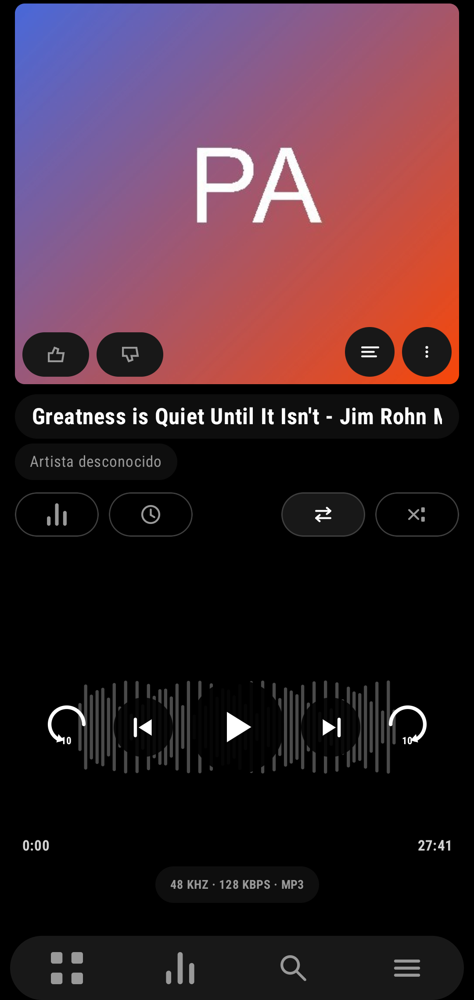
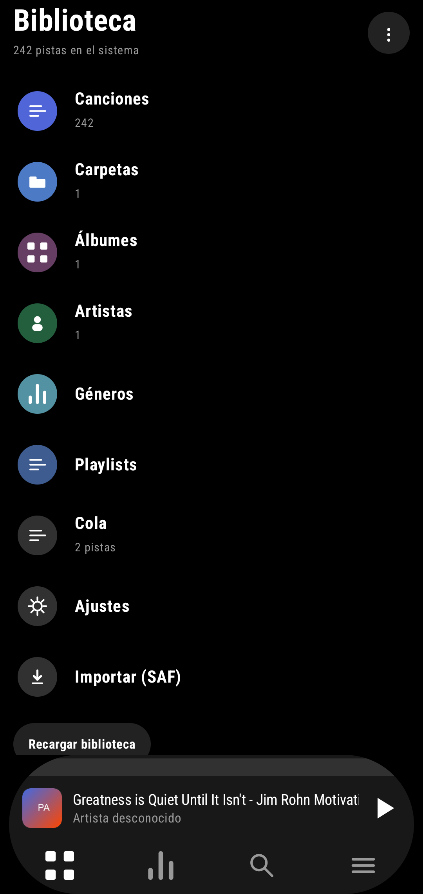
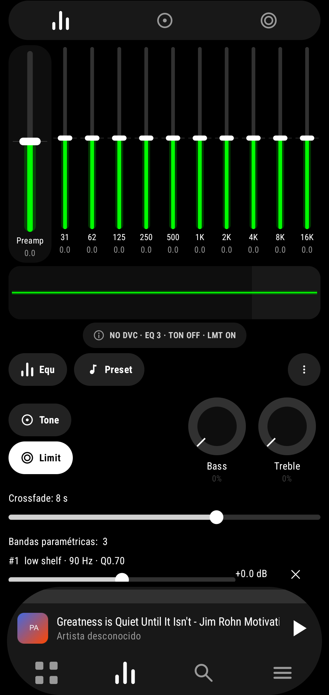
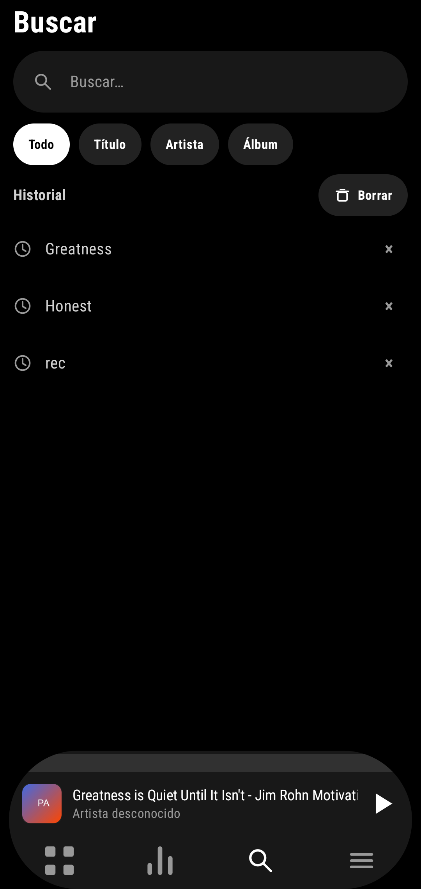

# PowerampFree

**Reproductor de música Android inspirado en Poweramp, reconstruido desde cero con Kotlin, Jetpack Compose y Media3.**

[](https://kotlinlang.org/)
[](https://developer.android.com/)
[](https://developer.android.com/jetpack/compose)
[](core/audio/src/test)
[](#clean-room-y-aviso-legal)

> *A clean-room, Poweramp-inspired Android music player built with Kotlin, Compose and Media3.*

PowerampFree es un reproductor de música para Android construido **desde cero**. Toma como
referencia visual las capturas de Poweramp (build 981) y como referencia de comportamiento
el análisis estático de APKs propios (Poweramp build 1032 y Poweramp Equalizer build 1028),
pero **no incluye código, recursos, layouts, iconos, intents ni marca de la app original**:
todo lo que hay aquí es implementación original.

El objetivo no es competir con Poweramp, sino aprender ingeniería de software, UI declarativa
y DSP construyendo una app real, usando un **CLI + un agente de IA** como compañeros de trabajo.
Cada sprint se implementó, se compiló, se probó, se instaló en un dispositivo físico y se
documentó antes de pasar al siguiente.

<p align="center">
  
</p>

---

## Capturas

| Biblioteca | Reproductor | Equalizador | Búsqueda |
|---|---|---|---|
|  |  |  |  |

Capturas tomadas en un Xiaomi tanzanite (Android 16). La barra de estado del sistema se recortó.

## Qué incluye

### Interfaz

- **Shell de 4 pestañas** — Biblioteca, EQ, Buscar y Menú — con iconos vectoriales dibujados
  con `Canvas` (sin assets de terceros), mini-player persistente y cola en vivo.
- **Reproductor** — carátula grande, like/dislike, título y artista en pastillas, modos de
  repetición y aleatorio, waveform interactiva (tap/drag para buscar), transporte circular,
  saltos de ±10 s, temporizador de sueño, chip con el formato real del decoder y acceso a letras.
- **Equalizador** — 10 bandas gráficas + preamp, curva de respuesta, Tone (Bass/Treble),
  limitador suave, presets, bandas paramétricas, crossfade y visualizador de espectro.
- **Biblioteca** — canciones, carpetas, álbumes, artistas, géneros, playlists y cola;
  explorador con breadcrumb, orden por audiencia y totales por subárbol.
- **Cola y búsqueda** — salto directo a cualquier pista, menú contextual por pista,
  búsqueda por título/artista/álbum con filtros e historial.
- **Playlists** — crear, añadir con deduplicación, reproducir, renombrar, eliminar y
  quitar pistas; incluidas en el backup.
- **Ajustes** — tema/acento, audio, biblioteca, carátulas, letras, export/import JSON.
- **Letras LRC** — línea activa, seguimiento automático y tap para saltar.
- **Integración Android** — `MediaSessionService`, foco de audio, gestos de headset,
  notificación multimedia y API propia de comandos por broadcast.

### Motor de audio

El módulo `:core:audio` es Kotlin/JVM puro, sin dependencias de Android, y se ejecuta en tests
rápidos y deterministas:

- `GainStage → ParametricEq → SoftLimiter` como cadena DSP.
- Biquads RBJ, bandas paramétricas y presets en JSON (con importación AutoEQ).
- Crossfade, auto-advance con guardas de sesión, shuffle y reproducción aleatoria.
- Analizador de espectro, parser LRC, políticas de biblioteca y de foco.
- **102 tests unitarios en verde.**

## Estado del proyecto

| Fase | Contenido | Estado |
|---|---|---|
| Sprints 1–10 | Playback, navegación, biblioteca, EQ, ajustes, letras, playlists, visualizador | ✅ |
| Sprints 11–12 | Shell visual, reproductor, EQ neón, cola, búsqueda, playlists y ajustes | ✅ |
| Próximo | Scroller A-Z, visualizador a pantalla completa, preferencias funcionales | 🔜 |

El detalle por bloque está en [`docs/FEATURES.md`](docs/FEATURES.md) y el historial de
verificación en dispositivo en
[`docs/archive/VERIFICATION-history.md`](docs/archive/VERIFICATION-history.md).

## Stack

| Área | Tecnología |
|---|---|
| Lenguaje | Kotlin 2.0.21 |
| UI | Jetpack Compose + Material 3 (tema oscuro propio, tokens medidos) |
| Reproducción | Media3 ExoPlayer 1.4.1 + `MediaSessionService` |
| DSP | `:core:audio` — Kotlin/JVM puro |
| Build | Gradle 8.10.2, AGP 8.7.3, JDK 17 |
| Android | `minSdk 26`, `targetSdk 35`, `compileSdk 35` |

## Estructura del repositorio

```text
PowerampFree/
├─ app/          # UI Compose, servicio Media3, stores y glue de Android
├─ core/audio/   # DSP, parser LRC, políticas y utilidades (JVM puro)
├─ docs/         # especificación UI, evidencia, arquitectura, features y capturas
│  ├─ screenshots/   # capturas de esta app
│  └─ ui-capture/    # capturas de la app de referencia (solo investigación)
└─ tools/        # Gradle/JDK y utilidades locales (no versionado)
```

## Cómo compilar y ejecutar

### Requisitos

- JDK 17
- Android SDK 35 (`ANDROID_HOME` o `ANDROID_SDK_ROOT` configurado)
- Gradle 8.10.2, o Android Studio reciente

> El repositorio no versiona el wrapper de Gradle ni el JDK (ver `.gitignore`).
> Puedes abrir el proyecto directamente en Android Studio o instalar Gradle 8.10.2.
> Si quieres generar el wrapper localmente:
>
> ```bash
> gradle wrapper --gradle-version 8.10.2
> ```

### Tests del core (sin Android SDK)

```bash
gradle :core:audio:test --console=plain
```

### App Android

```powershell
# Windows PowerShell
$env:ANDROID_HOME = "$env:LOCALAPPDATA\Android\Sdk"
gradle :app:assembleDebug --console=plain
```

```bash
# Linux / macOS
export ANDROID_HOME="$HOME/Android/Sdk"
gradle :app:assembleDebug --console=plain
```

El APK queda en `app/build/outputs/apk/debug/app-debug.apk`.

### Instalar en un dispositivo

```bash
adb install -r app/build/outputs/apk/debug/app-debug.apk
```

En el primer arranque concede el permiso de audio. La app funciona con la biblioteca del
sistema (MediaStore) y también permite importar una carpeta con SAF.

> `settings.gradle.kts` excluye `:app` automáticamente si no detecta el SDK de Android,
> de modo que `:core:audio:test` se puede ejecutar en cualquier máquina con JDK 17.

## Documentación

| Documento | Contenido |
|---|---|
| [`docs/UI_SPEC.md`](docs/UI_SPEC.md) | Especificación visual medida desde las capturas y tabla de brechas |
| [`docs/EVIDENCE.md`](docs/EVIDENCE.md) | Hallazgos del análisis estático de los APKs de referencia |
| [`docs/INTEGRATION.md`](docs/INTEGRATION.md) | Arquitectura, mapa de código y API de comandos |
| [`docs/FEATURES.md`](docs/FEATURES.md) | Estado por bloque y roadmap |
| [`docs/archive/VERIFICATION-history.md`](docs/archive/VERIFICATION-history.md) | Verificación sprint a sprint en dispositivo |
| [`docs/ui-capture/`](docs/ui-capture) | Capturas de la app de referencia usadas como evidencia |

## Cómo se hizo

El proyecto se desarrolló en **sprints verticales**. Cada sprint seguía el mismo ciclo:

1. Implementar una porción funcional y visual.
2. Compilar (`:app:assembleDebug`) y ejecutar los tests del core.
3. Instalar el APK en un dispositivo físico y verificar pantalla por pantalla.
4. Documentar lo aprendido y las limitaciones.
5. Commit y siguiente sprint.

La IA se usó para escribir y revisar código, ejecutar Gradle/adb, analizar capturas y mantener
la documentación; las decisiones de diseño se contrastaron siempre contra capturas reales y
pruebas en dispositivo. El resultado es también un experimento sobre **qué tan lejos llega un
modelo gratuito trabajando dentro de un CLI**.

## Limitaciones conocidas

- No es bit-exacto con el motor nativo de la referencia: se busca equivalencia de comportamiento.
- El crossfade entre dos decoders es exacto en DSP, pero aproximado en fase.
- Aún no hay scrobbling, Android Auto, scroller A-Z ni visualizador a pantalla completa.
- La carátula depende del proveedor de MediaStore o de archivos de portada en la carpeta.
- La interfaz está en español; algunas preferencias siguen en fase visual.
- El proyecto es educativo y personal: no se distribuye como sustituto de Poweramp.

## Clean-room y aviso legal

- **Poweramp** y **Poweramp Equalizer** son marcas de sus respectivos propietarios (Max MP).
  Este proyecto **no está afiliado, patrocinado ni respaldado** por ellos.
- El análisis estático se hizo únicamente sobre APKs propios del autor. Los artefactos de
  análisis (`extract/`, `targets/`) **no se versionan** y no forman parte de la app.
- No se copiaron recursos, layouts, iconos, sonidos, cadenas ni código de la app original.
  Los iconos se dibujan con `Canvas` y la marca del proyecto es **POWERAMPFREE**.
- Las capturas de `docs/ui-capture/` son evidencia de investigación y **no se incluyen en el APK**.
- Las capturas de `docs/screenshots/` son de esta implementación.

## Créditos

- Referencia visual y de comportamiento: Poweramp (build 981) y Poweramp Equalizer (build 1028),
  analizados a partir de copias propias.
- Herramientas de análisis: REA 6.7.0 y jadx-headless-mcp 0.7.1 (solo para investigación).
- Construido con Kotlin, Jetpack Compose, Media3 y Gradle.

---

Si este proyecto te resulta útil para aprender, siéntete libre de abrir un issue o dejar una
estrella. Las contribuciones y sugerencias son bienvenidas.
